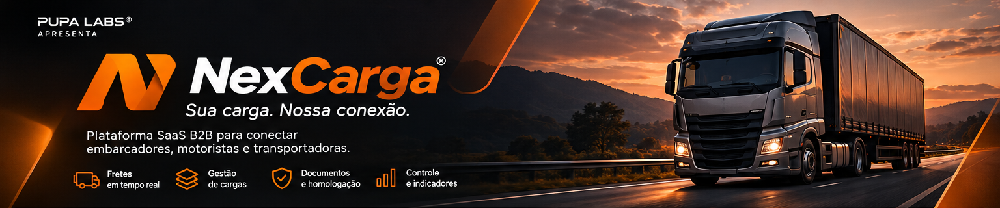
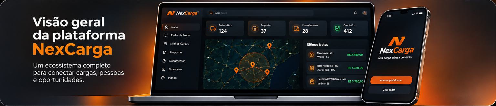
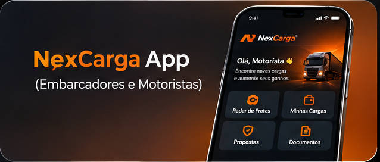
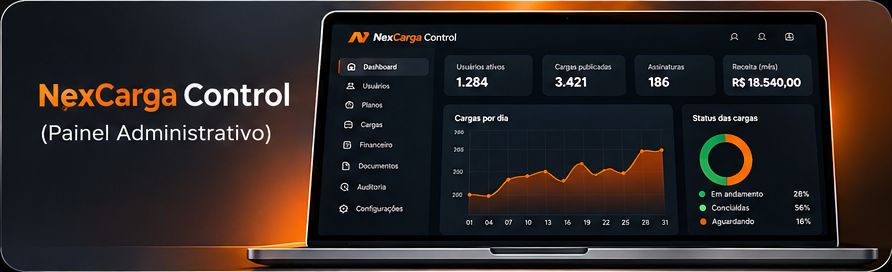

<!-- ===================================================== -->
<!-- NEXCARGA | OFFICIAL README -->
<!-- DESENVOLVIDO POR PUPA LABS -->
<!-- © 2026 PUPA LABS - TODOS OS DIREITOS RESERVADOS -->
<!-- ===================================================== -->

   

  

  <h3>SUA CARGA. NOSSA CONEXÃO.</h3>

  

    <strong>O futuro da conexão logística começa aqui.</strong>
  

  

    

  
  
  

    

  

    <strong>Conectando embarcadores, transportadoras e motoristas.</strong>
     
    Tecnologia, inteligência e eficiência para transformar a logística.
  

   

---

  <h2>01 · SOBRE A NEXCARGA</h2>

  

    <strong>Mais conexão. Mais oportunidades. Mais eficiência.</strong>
  

A **NexCarga** é uma plataforma SaaS B2B desenvolvida para conectar os diferentes participantes do setor de transporte e logística em um único ambiente digital.

Nossa proposta é simplificar a comunicação comercial, aproximar quem precisa transportar de quem possui capacidade de transporte e oferecer ferramentas inteligentes para gerenciamento de operações logísticas.

A plataforma foi concebida para proporcionar uma experiência integrada entre embarcadores, empresas, transportadoras e motoristas autônomos.

<table>
  <tr>
    <td align="center" width="25%">
      <h2>◈</h2>
      <strong>Conexão</strong>
       
      Integração entre os participantes da logística.
    </td>
    <td align="center" width="25%">
      <h2>⌖</h2>
      <strong>Oportunidades</strong>
       
      Descoberta de oportunidades de frete.
    </td>
    <td align="center" width="25%">
      <h2>▤</h2>
      <strong>Gestão</strong>
       
      Organização das operações e documentos.
    </td>
    <td align="center" width="25%">
      <h2>↗</h2>
      <strong>Eficiência</strong>
       
      Inteligência para decisões logísticas.
    </td>
  </tr>
</table>

---

  <h2>02 · VISÃO GERAL DA PLATAFORMA</h2>

  

    <strong>Um ecossistema. Múltiplas soluções. Uma conexão.</strong>
  

  

   

  
    Representação visual conceitual do ecossistema NexCarga.
  

---

  <h2>03 · ECOSSISTEMA NEXCARGA</h2>

  

    <strong>Uma estrutura modular desenvolvida para atender às necessidades da logística moderna.</strong>
  

<table width="100%">
  <thead>
    <tr>
      <th align="center">MÓDULO</th>
      <th align="left">FUNCIONALIDADE</th>
      <th align="left">OBJETIVO</th>
    </tr>
  </thead>
  <tbody>
    <tr>
      <td align="center"><strong>RADAR DE FRETES</strong></td>
      <td>Busca georreferenciada de oportunidades.</td>
      <td>Conectar cargas, localização, origem, destino e veículos.</td>
    </tr>
    <tr>
      <td align="center"><strong>PUBLICAÇÃO DE CARGAS</strong></td>
      <td>Cadastro e gerenciamento de ofertas.</td>
      <td>Facilitar a divulgação e gestão de fretes.</td>
    </tr>
    <tr>
      <td align="center"><strong>CONEXÕES E PROPOSTAS</strong></td>
      <td>Comunicação e negociação comercial.</td>
      <td>Aproximar contratantes e prestadores.</td>
    </tr>
    <tr>
      <td align="center"><strong>NEXCARGA DOCS</strong></td>
      <td>Gestão e centralização documental.</td>
      <td>Organizar documentos e processos de validação.</td>
    </tr>
    <tr>
      <td align="center"><strong>NEXIA</strong></td>
      <td>Assistência inteligente.</td>
      <td>Apoiar usuários e operações da plataforma.</td>
    </tr>
    <tr>
      <td align="center"><strong>NEXIA VERIFY</strong></td>
      <td>Validação e homologação documental.</td>
      <td>Apoiar a conferência de documentos.</td>
    </tr>
    <tr>
      <td align="center"><strong>MOTOR DE CUSTOS</strong></td>
      <td>Estimativas de custos logísticos.</td>
      <td>Apoiar o planejamento de transporte.</td>
    </tr>
    <tr>
      <td align="center"><strong>PLANOS E FINANCEIRO</strong></td>
      <td>Gestão de assinaturas e informações financeiras.</td>
      <td>Administrar os recursos comerciais da plataforma.</td>
    </tr>
    <tr>
      <td align="center"><strong>NEXCARGA CONTROL</strong></td>
      <td>Administração e auditoria.</td>
      <td>Gerenciar usuários, permissões, indicadores e configurações.</td>
    </tr>
  </tbody>
</table>

---

  <h2>04 · NEXCARGA APP</h2>

  

    <strong>A experiência logística na palma da mão.</strong>
  

  

    

O **NexCarga App** é a interface destinada aos usuários da operação logística, incluindo motoristas, embarcadores e empresas.

**Principais recursos previstos:**

- Radar de fretes georreferenciado.
- Pesquisa de oportunidades.
- Publicação e acompanhamento de cargas.
- Envio e gerenciamento de propostas.
- Gestão documental.
- Cadastro de veículos.
- Perfil e gerenciamento de conta.
- Acompanhamento das operações.

---

  <h2>05 · NEXCARGA CONTROL</h2>

  

    <strong>Inteligência administrativa e controle operacional.</strong>
  

  

    

O **NexCarga Control** é o ambiente administrativo central da plataforma, concebido para oferecer gerenciamento, monitoramento e controle das operações.

**Principais recursos previstos:**

- Dashboard administrativo.
- Gerenciamento de usuários.
- Controle de empresas e motoristas.
- Gestão de cargas e fretes.
- Administração de planos e assinaturas.
- Configurações financeiras.
- Controle de taxas e comissões.
- Indicadores e relatórios.
- Gerenciamento de permissões.
- Auditoria administrativa.

---

  <h2>06 · TECNOLOGIA E ARQUITETURA</h2>

  

    <strong>Engenharia de software orientada à escalabilidade e segurança.</strong>
  

A NexCarga foi concebida com uma arquitetura modular, preparada para integração de serviços, evolução contínua e expansão das funcionalidades.

**Diretrizes de desenvolvimento:**

| Pilar | Diretriz |
|---|---|
| Arquitetura | Estrutura modular e escalável |
| Backend | Processamento centralizado das operações |
| Banco de dados | Persistência estruturada e integridade |
| Autenticação | Controle de acesso e gerenciamento de sessões |
| Segurança | Proteção de dados e permissões |
| Armazenamento | Gestão de arquivos e documentos |
| Integrações | Serviços externos e APIs |
| Experiência | Interface responsiva e PWA |

<blockquote>
  <strong>Engenharia Pupa Labs:</strong>
  arquitetura, segurança, organização de código e evolução contínua fazem parte das diretrizes de desenvolvimento do projeto.
</blockquote>

---

  <h2>07 · PROPÓSITO E VISÃO</h2>

  

    Queremos construir um ambiente onde a logística seja mais conectada,
    acessível, inteligente e eficiente.
  

   

  <table width="100%">
    <tr>
      <td align="center">
        <strong>01 · CONECTAR</strong>
         
        Aproximar os participantes do setor logístico.
      </td>
      <td align="center">
        <strong>02 · SIMPLIFICAR</strong>
         
        Reduzir barreiras na comunicação e operação.
      </td>
    </tr>
    <tr>
      <td align="center">
        <strong>03 · INTELIGÊNCIA</strong>
         
        Utilizar tecnologia para apoiar decisões.
      </td>
      <td align="center">
        <strong>04 · EVOLUIR</strong>
         
        Construir soluções para uma logística melhor.
      </td>
    </tr>
  </table>

---

  <h2>08 · AUTORIA, PROPRIEDADE INTELECTUAL E DIREITOS</h2>

   

  

  <h3>Uma criação Pupa Labs.</h3>

A **NexCarga** é um produto concebido, projetado e desenvolvido pela **Pupa Labs**, responsável pela criação e desenvolvimento da solução e de seus elementos proprietários.

**Aviso de propriedade intelectual**

© 2026 Pupa Labs. Todos os direitos reservados.

A marca NexCarga, seu slogan **"Sua carga. Nossa conexão."**, identidade visual, layouts, elementos gráficos, textos originais, arquitetura, estrutura de software e código-fonte original do projeto são protegidos pela legislação aplicável de propriedade intelectual e direitos autorais.

É proibida a reprodução, cópia, distribuição, engenharia reversa quando vedada pela legislação, modificação, comercialização ou exploração não autorizada de materiais e componentes proprietários do projeto.

A utilização de marcas, serviços, bibliotecas e tecnologias de terceiros permanece sujeita às respectivas licenças e condições de seus titulares.

A disponibilização deste repositório não representa concessão automática de licença comercial ou transferência de propriedade intelectual.

---

   

  

  <h3>SUA CARGA. NOSSA CONEXÃO.</h3>

   

  <strong>DESENVOLVIDO POR PUPA LABS®</strong>

  

    WEB APPS · SOFTWARE · INTELIGÊNCIA ARTIFICIAL · INOVAÇÃO
  

  

    

  
    © 2026 Pupa Labs. Todos os direitos reservados.
  

    

<!-- END OF OFFICIAL NEXCARGA README -->
